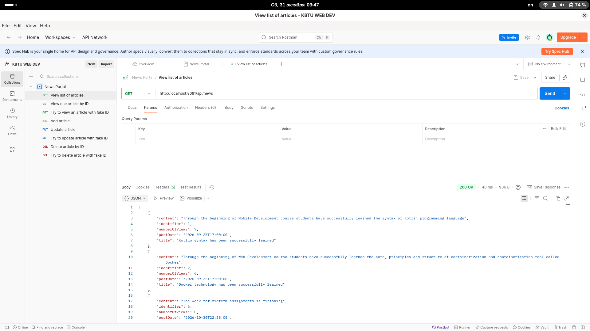
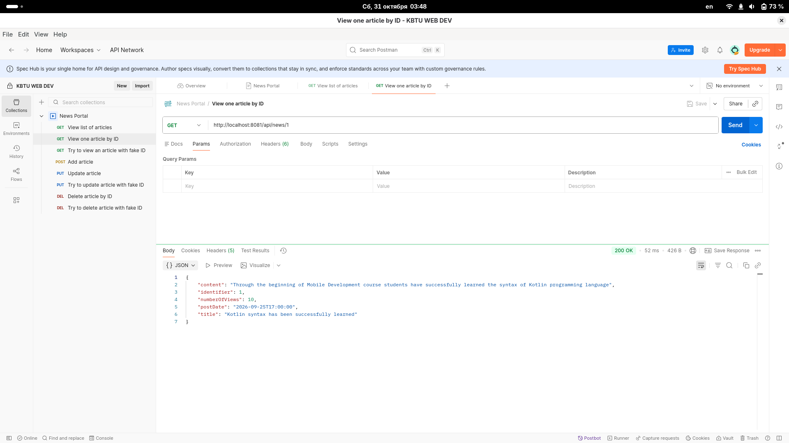
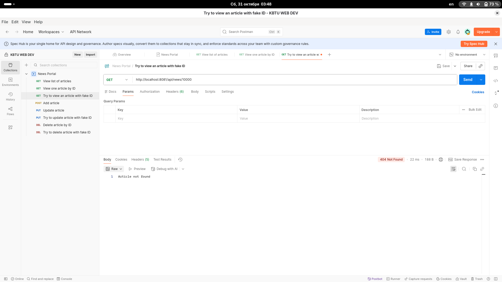
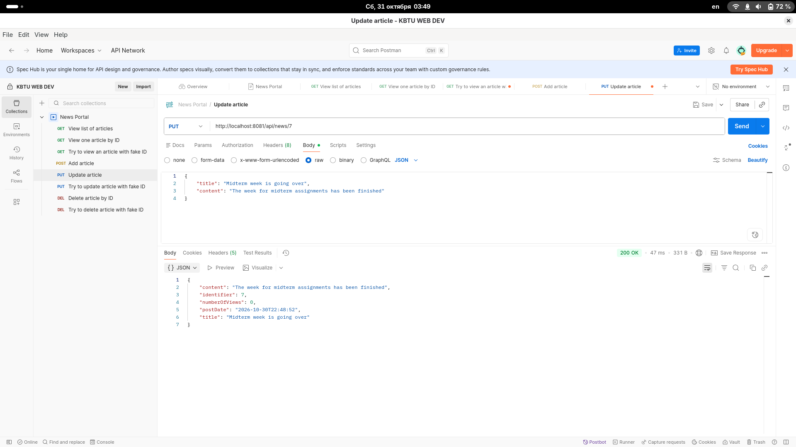
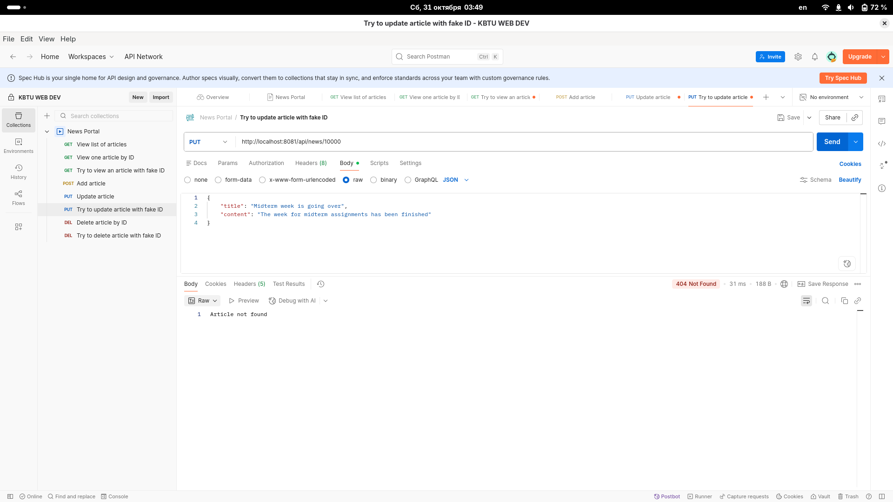
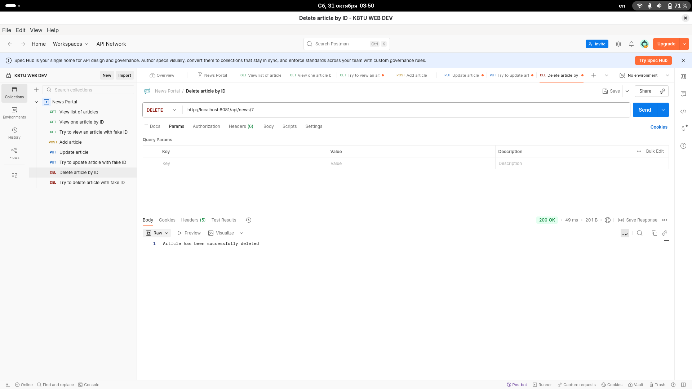

The project represents a news portal, where user can list, view, add, update and delete some article of the news.
Initially, 2 articles will be stored at database by migration.
The entity contains columns such as id, title, content, views (number of views) and post date.
When we add or update article, we can set only title and content. The identifier, number of views and post date will be set up by the application automaticall.
Each time user fetches an article by id to view, the number of views will be increased.

The swagger is avaliable by the link: http://localhost:8081/swagger-ui/index.html
The specification: http://localhost:8081/v3/api-docs

View list of news:

View article by ID:

Trial to view article with fake ID:

Add article:

Update article:

Trial to update article with fake ID:

Delete article:

Trial to delete article with fake ID:
