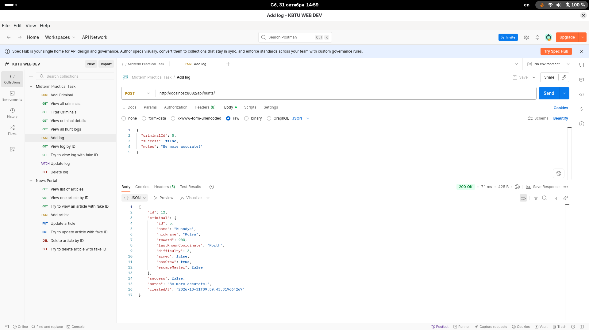

To begin with, I have failed to upload .env file.
In order to test application, you need to create this file with the following properties:
<ul>
    <li>DB_USR</li>
    <li>DB_PWD</li>
    <li>DB_NAME</li>
    <li>DB_PORT</li>
    <li>DB_EXTERNAL_PORT</li>
    <li>APP_PORT</li>
    <li>APP_EXTERNAL_PORT</li>
</ul>

For this application I also failed to create seeding migrations, I have added criminals and logs by POST HTTP-requests.

Add criminal:
![Снимок экрана от 2026-10-31 14-37-06.png]

View all criminals:
![Снимок экрана от 2026-10-31 14-37-16.png]

Filter criminals:
![Снимок экрана от 2026-10-31 14-40-30.png]

View criminal details by ID:
![Снимок экрана от 2026-10-31 14-42-10.png]

View hunt logs:
![Снимок экрана от 2026-10-31 14-48-57.png]

View log by ID:
![Снимок экрана от 2026-10-31 14-42-10.png]

View log with fake ID:
![Снимок экрана от 2026-10-31 14-50-27.png]

Add log:

Update log:
![Снимок экрана от 2026-10-31 14-51-37.png]

Delete log:
![Снимок экрана от 2026-10-31 14-52-08.png]

The swagger is available by the link: http://localhost:8082/swagger-ui/index.html
The specification: http://localhost:8082/v3/api-docs
